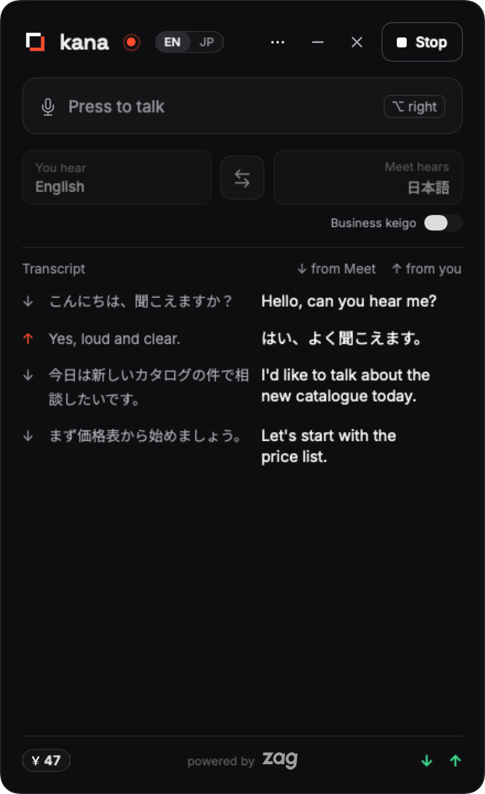
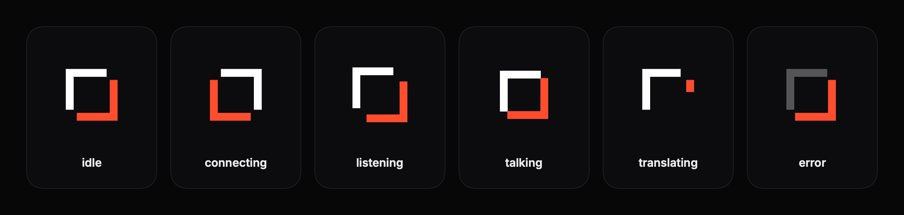
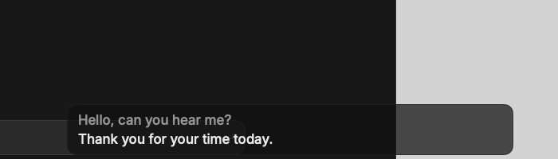
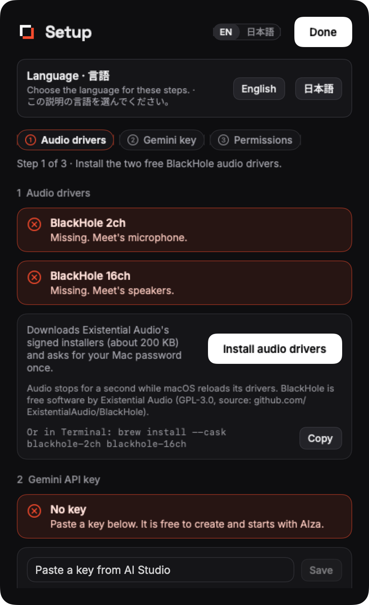

<p align="center">
  
</p>

<h1 align="center">kana</h1>

<p align="center">
  <b>かな · live Japanese ⇄ English interpreting</b><br>
  macOS で、どの会議アプリでも使える日英のリアルタイム通訳。あなたが英語で話すと、相手には日本語で、あなたの声のまま届く。
</p>

<p align="center">
  <a href="LICENSE"></a>
  <a href="https://github.com/selvaragulkumar/kana/releases"></a>
  
  
</p>

<p align="center">
  <a href="README.md">English</a> · 日本語
</p>

<!-- demo GIF (docs/demo.gif) は予定。必要な内容は英語版 README のコメントを参照。 -->
<p align="center">
  
  <br><sub>通訳中のパネル。デモ GIF は準備中。</sub>
</p>

## 要約

```text
会議の音声 ─► BlackHole 16ch ─► Gemini Live (ja→en) ─► あなたのイヤホン
あなたのマイク ──────────────────► Gemini Live (en→ja) ─► BlackHole 2ch ─► 会議アプリのマイク
```

Gemini Live のセッションを 2 本、並べて動かす。1 本は会議の音声を通訳してイヤホンに流す。もう 1 本はあなたの声を通訳して会議に流す。こちらは Talk がオンのときだけ動く。メニューバーのパネルには、両方向の文字起こし、遅延、その時点までの料金が表示される。

**現状 (2026-11-12)。** 録音したクリップと実際の Gemini API で動作を確認済み。実際の Google Meet の通話での確認はまだこれから。

以下、既定の言語 (あなたが聞くのは英語、会議が聞くのは日本語) で説明する。

## 想定する利用者

- 日本語と英語の通話に参加し、相手があなたの言語をあまり話せない人。
- 文字を打つのではなく話したい人。相手には字幕ではなく声で届けたい人。
- Mac で Google Meet、Zoom、Microsoft Teams など、マイクとスピーカーを選べる会議アプリを使う人。
- 自分の Gemini API キーを用意し、発話の秒数分を Google に支払うことに抵抗がない人。
- 午後のうちに全部読める小さなツールがほしい人。Python と Swift のファイルが数個だけ。

会場全体の通訳、録音の翻訳、イヤホンを使えない会議には向かない。十分にテストしているのは日本語と英語の組み合わせ。他の組み合わせもプリセットや BCP-47 コードで使えるが、テストは少ない。

## 他のツールとの違い

> かな · live Japanese ⇄ English interpreting。マークは日本語のかぎかっこ 「 」。二つの言語のあいだの空間を表す。

<p align="center"></p>

一部を担うオープンソースのプロジェクトはいくつもある。近いものは 2 つ。

- **[Sokuji](https://github.com/kizuna-ai-lab/sokuji)** は同じ双方向の考え方を、同じ Gemini Live Translate モデルを含む 8 つのプロバイダ、ローカルモデル、Chrome 拡張で実現している。Electron アプリで、macOS では受信側にシステム音声全体を取り込み、分析ツールを組み込んでいる。多くのプロバイダやブラウザ拡張がほしいなら Sokuji を使うとよい。
- **[Cicada](https://github.com/wquguru/cicada)** は完成度の高いネイティブのメニューバーアプリで、字幕、会議メモ、送信側のプッシュトゥトーク通訳を備える。受信側は音声ではなく字幕。メモと字幕がほしいなら Cicada を使うとよい。

kana にあって、他では組み合わせとして見つからなかったもの:

- **両方向とも音声で、声を保ったまま通訳する。** 会議の音声は話し手の声に近い英語で聞こえる。あなたの発言は、あなたの声に近い日本語で会議に届く。これは Gemini Live Translate の声の再現 (voice mirroring) による。敬語を確実にしたい場合は、`--register business` で声と引き換えにできる ([敬語の度合い](#敬語の度合い-register) を参照)。
- **構造上ループしない配線。** 会議アプリのスピーカーとマイクを別々の仮想デバイスにしているので、エンジンが聞くのは会議だけ、通訳を聞くのは会議だけになる。詳しくは [docs/ARCHITECTURE.md](docs/ARCHITECTURE.md#why-the-routing-cannot-loop) (英語)。
- **料金と遅延を画面に表示。** フッターに、Google 自身のトークン数から出した料金の累計と、方向ごとの発話から通訳音声までの遅延の中央値を表示する。
- **無音は送らない。** 音声区間検出 (VAD) のゲートが無音を止める。送らなかった無音には課金されない。
- **同じ言語の発話には黙る。** あなたが自分で日本語を話すと、送信側は何も出さない。文の途中で言語を切り替えても問題ない。
- **スクリプトから使えるエンジン。** 同じ Python エンジンを、ターミナルからでも、テストからでも、JSON Lines のプロトコル経由でアプリからでも動かせる。
- **テレメトリなし。** 通信先は下に書いた 1 つだけ。

## 動作環境

| 項目 | バージョンや内容 |
|---|---|
| macOS | 14 Sonoma 以降 |
| Mac | Apple シリコン (確認済み)。Intel は未確認 |
| Python | 3.13 (エンジン用) |
| Xcode Command Line Tools | アプリのビルド用 (`xcode-select --install`)。Xcode 本体は不要 |
| [Homebrew](https://brew.sh) | BlackHole のインストール用 |
| BlackHole 2ch と BlackHole 16ch | 無料の仮想オーディオドライバ ([BlackHole](https://github.com/ExistentialAudio/BlackHole)、GPL-3.0、別途インストール) |
| Gemini API キー | [Google AI Studio](https://aistudio.google.com/apikey) で作成。料金は Google からあなたに請求される |
| イヤホン | 必須。スピーカーだと通訳音声がマイクに回り込む |

## インストール

### ダウンロード

[Releases](https://github.com/selvaragulkumar/kana/releases) ページから `kana-<version>.dmg` (Apple silicon) か `kana-<version>-intel.dmg` をダウンロードし、DMG を開いて **kana** を **アプリケーション** にドラッグする。公証前のリリースは、初回だけ macOS 14 では右クリック › **開く**、macOS 15 以降ではシステム設定 › プライバシーとセキュリティ › **このまま開く** が必要。起動すると **Setup** が順番に案内する: (1) **Install audio drivers** を押し、Mac のパスワードを一度入力すると BlackHole 2ch と 16ch が入る (Existential Audio の署名付きインストーラをダウンロードし、Homebrew の cask と同じ SHA-256 を確認する。再起動は不要)。(2) [Google AI Studio](https://aistudio.google.com/apikey) で作った Gemini API キーを貼って **Save**。(3) マイクとアクセシビリティを許可する。Python などのインストールは要らない (アプリに同梱、約 140 MB)。詳しくは [英語版 README](README.md#download)。

### Homebrew (予定)

BlackHole の 2 つのドライバも一緒に入る tap の cask を用意する予定。それまでは DMG かソースからのビルドを使う。

### ソースからビルド

```sh
# 1. 仮想オーディオデバイス (Mac のパスワードを聞かれる。終わったらログアウトするか再起動する)
brew install --cask blackhole-2ch blackhole-16ch

# 2. エンジン
git clone https://github.com/selvaragulkumar/kana.git
cd kana
python3.13 -m venv .venv
.venv/bin/pip install -e .

# 3. メニューバーアプリ
app/build.sh --install               # ビルドして kana.app を /Applications にコピー
open /Applications/kana.app
```

`build.sh --install` は、まだ設定がなければ、このチェックアウトをエンジンのフォルダとして記録する。チェックアウトを移動したら、アプリの Setup ページでフォルダを選び直す。

**API キー。** パネルの ••• メニューから **Setup…** を開き、Gemini のキーを貼り付けて **Save** を押す。キーはログインキーチェーンに保存される。コマンドラインで使う場合や、キーチェーンにキーがない場合の代わりとして、エンジンは `.env` ファイルも読む:

```sh
printf 'GEMINI_API_KEY=%s\n' 'paste-your-key-here' > .env
chmod 600 .env
```

macOS では `sounddevice` が PortAudio ライブラリを同梱しているので、PortAudio を別に入れる必要はない。`ffmpeg` (`brew install ffmpeg`) はテストや下の WAV の例を動かすときだけ必要。

アプリはアドホック署名なので、初回は macOS が開いてよいか確認してくることがある。

## 配線

kana は 4 つのオーディオデバイスを使う。そのうち 2 つは BlackHole の仮想ケーブルで、一方の端に流した音がもう一方の端から出てくる。

| デバイス | 種類 | 音を流す側 | 音を拾う側 |
|---|---|---|---|
| あなたのマイク | 録音デバイス | あなたの声 | kana (送信側) |
| BlackHole 2ch | 仮想ケーブル | kana (送信側の通訳) | 会議アプリ。**マイク**として |
| BlackHole 16ch | 仮想ケーブル | 会議アプリ。**スピーカー**として | kana (受信側) |
| あなたのイヤホン | 再生デバイス | kana (受信側の通訳) | あなたの耳 |

つまり、会議にあなたの生のマイクは届かず、イヤホンに通訳前の会議音声は届かない。

会議アプリの設定は一度だけ:

| アプリ | 場所 | マイク | スピーカー |
|---|---|---|---|
| Google Meet (ブラウザ) | 設定 (歯車アイコン) › 音声 | BlackHole 2ch | BlackHole 16ch |
| Zoom (デスクトップ)。未検証 | 設定 › オーディオ | BlackHole 2ch | BlackHole 16ch |
| Microsoft Teams (デスクトップ)。未検証 | 設定 › デバイス › オーディオ デバイス | BlackHole 2ch | BlackHole 16ch |

macOS の出力はイヤホンのままにしておく (システム設定 › サウンド › 出力)。kana では、実際のマイクとイヤホンを選ぶ。BlackHole の 2 つは固定なので設定は要らない。

アプリの **Setup** ページ (••• › **Setup…**) が配線を確認してくれる。デバイスやキーのエラーで起動に失敗したときは自動で開く。メインのパネルには配線や BlackHole の警告は出ず、Setup にまとめてある。BlackHole の 2 つのデバイス、マイクとアクセシビリティの許可、キー、会議アプリの設定、インストール用のコマンドを表示する。**Test devices** は各 BlackHole に 1 秒の音を流し、それが聞こえるかを確かめる。通話中には実行しないこと。

Zoom と Teams も Meet と同じ 2 つの設定が必要だが、まだ試していない。

## 使い方

### メニューバーアプリ

<p align="center"> </p>

1. メニューバーの kana のマークをクリックする。
2. **Microphone** (実際のマイク) と **Earphones** を選ぶ。選んだものは記憶される。
3. 言語のカードを確認する。左が **You hear English**、右が **Meet hears 日本語** で、間の ⇄ ボタンで入れ替えられる。どちらかのカードをクリックするとプリセットが開く。プリセットは英語と、日本語、中国語、韓国語、スペイン語、フランス語、ドイツ語、ヒンディー語、タミル語のいずれかの組み合わせ。**Custom…** では任意の BCP-47 コードを 2 つ指定できる。
4. 会議が日本語を聞く場合、カードの下の右側に小さな **Business keigo** のスイッチが出る。既定はオフで、日本語はあなたの話し方をそのまま映す。オンにすると `--register business` になる。スイッチのツールチップに、送信側の声が既製の声になることが書かれている。オンの間、右のカードは "Meet hears · business keigo" と表示される。[敬語の度合い](#敬語の度合い-register) を参照。
5. **Start** を押す。2 本のセッションがつながり、ヘッダーの表示が Idle から Live に変わり、受信側の通訳がすぐに始まる。
6. 自分の声を送るときは、トークバー ("Press to talk ⌃⌥ Space") を押すか、どのアプリからでも **⌃⌥Space** を押す。押している間だけではなく、押すたびにオンとオフが切り替わる。オンの間は "Talking · English → 日本語" と表示される。送信側は必ずミュートで始まる。もう一度押すとミュートに戻る。
7. 文字起こしで両方向の内容を確認する。フッターには通話時間と料金の累計が "0:00 · $0.00 · ≈¥0" のように出る。エンジンが Google のトークン数を報告するまでは " est." が付く。IN と OUT のラベルには、接続中は緑の点と遅延の中央値が "IN live · 1.8 s" のように出る。

ヘッダーの点線のチップは、`gemini-3.8-live` を使っているときは "fallback model"、`app/fake_engine.py` でテストしているときは "fake engine" と表示する。既定のモデルでは何も出ない。

**字幕。** 既定はオフ。••• メニューか、メニューバーアイコンの右クリックでオンにする。画面下部の、クリックを透過する小さな帯 (幅は最大 560 pt) に、聞こえた最新の 1 行と、薄く表示した 1 つ前の行が出る。各行は最後の更新から 8 秒で消える。帯は他のアプリより前面に出て、パネルを閉じていても動く。

<p align="center"></p>

**画面共有。** パネルと字幕の帯は、既定で画面共有、録画、スクリーンショットに映らない。映したいときは ••• メニューの **Visible in screen share** をオンにする。

**文字起こし。** ••• メニューの **Save transcripts** をオフにしない限り、各通話は Markdown と SRT で保存される。同じメニューに **Open Last Transcript** と **Transcripts Folder** がある。

**Setup。** ••• › **Setup…** に、BlackHole の 2 つのデバイスとインストール用のコマンド、ループバックのテスト、エンジンのフォルダ、マイクとアクセシビリティの許可、API キーがまとめてある。[配線](#配線) を参照。

<p align="center"></p>

**ホットキー。** ⌃⌥Space にはアクセシビリティの許可が必要。パネルの **Open Settings** を押し、プライバシーとセキュリティ › アクセシビリティで kana をオンにする。許可がなくてもトークバーは使える。

### コマンドライン

エンジンはターミナル単体でも動く:

```sh
.venv/bin/python -m kana --spk "AirPods"
```

**スペース**で Talk を切り替え、**q** で終了する。両方向の文字起こしが届いた順に表示される。venv の中では `kana` コマンドとしても使える。

| フラグ | 既定値 | 意味 |
|---|---|---|
| `--mic NAME` | システムの既定の入力 | 実際のマイク (大文字小文字を区別しない部分一致) |
| `--spk NAME` | システムの既定の出力 | イヤホン |
| `--meet-mic NAME` | BlackHole 2ch | 会議アプリがマイクとして使うデバイス |
| `--meet-spk NAME` | BlackHole 16ch | 会議アプリがスピーカーとして使うデバイス |
| `--in LANG` | `en` | あなたが聞く言語 (BCP-47) |
| `--out LANG` | `ja` | 会議が聞く言語 (BCP-47) |
| `--model ID` | `gemini-3.5-live-translate-preview` | Live モデル。安定版の代替は `gemini-3.8-live` |
| `--register default\|business` | `default` | 送信側の日本語の敬語の度合い。[敬語の度合い](#敬語の度合い-register) を参照 |
| `--vad auto\|off` | `auto` | VAD のゲート。`auto` は無音を送らない。`off` はすべて送る |
| `--vad-threshold N` | `200` | 発話とみなす最小の音量 (100 ms の int16 チャンクの RMS)。背景雑音も自動で学習する |
| `--vad-hangover MS` | `2000` | 発話の終わった後も送り続ける時間。モデルが文を言い終えるため |
| `--catch-up on\|off` | `on` | 再生が遅れている間、モデルが流す無音を捨てて次の訳を早く聞かせる |
| `--capture-latency low\|default` | `low` | BlackHole の録音を低レイテンシ・10 ms ブロックで開く。会議の音声が約 60 ms 早くモデルに届く。マイクは変わらない |
| `--backend developer\|vertex` | `developer` | セッションを Gemini Developer API (`GEMINI_API_KEY`) か Vertex AI の `global` (gcloud のアプリケーションデフォルト認証情報、`--gcp-project`) で動かす |
| `--save-dir DIR` | `~/Library/Application Support/kana` | 文字起こしの保存先は `DIR/transcripts/` |
| `--no-save` | | 文字起こしを保存しない |
| `--only in\|out` | 両方 | 片方向だけ動かす |
| `--in-file X.wav` / `--out-file X.wav` | | 会議の音声やマイクを WAV で置き換える。セッションがつながってから再生が始まる |
| `--dump-in X.wav` / `--dump-out X.wav` | | 通訳音声も保存する |
| `--list-devices [--json]` | | オーディオデバイスを一覧して終了 |
| `--json` | | stdout に JSON Lines、stdin でコマンド。アプリ用 ([プロトコル](docs/ENGINE.md)、英語) |

会議なしで受信側を試す:

```sh
say -v Kyoko -o /tmp/ja.aiff "こんにちは、今日は天気がいいですね。"
ffmpeg -y -i /tmp/ja.aiff -ar 16000 -ac 1 /tmp/ja.wav
.venv/bin/python -m kana --only in --in-file /tmp/ja.wav --dump-in /tmp/en.wav
```

## プライバシーと権限

| macOS の権限 | 理由 | 許可しない場合 |
|---|---|---|
| マイク | マイクと BlackHole 16ch の音を録るため | 音声を取り込めず、何も通訳されない |
| アクセシビリティ | 別のアプリが前面にあるときに ⌃⌥Space を受け取るため | グローバルホットキーが効かない。トークバーは使える |

マイクの音声が送られるのは Talk がオンのときだけ。会議の音声はエンジンが動いている間送られる。既定では両方向とも VAD のゲートが無音を止めるので、Mac の外に出るのは発話とその前後の短い余白だけ。`--dump-in` や `--dump-out` を付けない限り、音声は保存されない。API キーはログインキーチェーン (または使っている場合は `.env`) に置かれ、Google への認証情報として送られる以外、Mac の外に出ない。詳しくは [SECURITY.md](SECURITY.md) (英語)。

**文字起こしは既定で保存される。** 実行ごとに Markdown の表と SRT ファイルが `~/Library/Application Support/kana/transcripts/` に日時の名前で書き出される。暗号化されていないテキストである。アプリでは **Save transcripts** をオフにし、コマンドラインでは `--no-save` や `--save-dir` を使う。

通話の参加者には、音声が通訳サービスに送られることを伝えること。

## 通信先の一覧

| 部品 | 通信先 | 用途 |
|---|---|---|
| エンジン (Python) | `generativelanguage.googleapis.com` | 2 本の Gemini Live セッション (TLS 上の WebSocket) |
| アプリ (Swift) | なし | エンジンとは stdin と stdout でだけやり取りする |

テレメトリ、分析、クラッシュレポート、更新確認はない。ソースからのインストール時には、通常どおり Homebrew、GitHub、PyPI に接続する。

## モデル

| モデル | 使う場面 | 補足 |
|---|---|---|
| `gemini-3.5-live-translate-preview` | 既定では両方向 | Gemini Live Translate。声の再現付きで音声から音声へ直接翻訳するので、通訳が話し手の声に近く聞こえる。プレビュー版なので、Google が変更や提供終了をすることがある。Gemini Developer API でのみ使え、Vertex AI では使えない。 |
| `gemini-3.8-live` | `--register business` の送信側、または `--model gemini-3.8-live` で両方向 | 一般提供の Live モデルに、システム指示を与えて使う。声は既製の声になる。 |

### 敬語の度合い (register)

日本語は丁寧さで形が変わる。`--register` で送信側の日本語の作り方を決める。

| `--register` | 受信側 | 送信側 (会議が日本語を聞く場合) | あなたの声 | 丁寧さ |
|---|---|---|---|---|
| `default` (既定) | Live Translate | Live Translate | 保たれる | あなたの話し方に合わせる |
| `business` | Live Translate | `gemini-3.8-live` と敬語の指示 | 既製の声 | です・ます調と敬語を保証 |

既定のモードは、あなたの話し方をそのまま映す。普通の、または丁寧な英語で話せば、会議には丁寧な日本語が届く。私たちのテストでは、普通または丁寧な入力 24 件のうち 24 件が丁寧語か敬語になった。くだけた英語はくだけた日本語になる。くだけた入力 12 件はすべてタメ口になった (例: 「うん、それでいいよ。」)。business モードでは 36 回中くだけた出力は 0 件で、31 件が完全な敬語だった。その代わり、あなたの声は失われ、遅延が約 0.45 秒増える。方法とすべての出力は [docs/REGISTER.md](docs/REGISTER.md) (英語) にある。

アプリでは、言語のカードの下にある **Business keigo** のスイッチで business モードをオンにする。パネルには既定のモードの説明が出ないので、丁寧な日本語にしたいときは普通の、または丁寧な英語で話すことを覚えておくこと。会議の言語が日本語でない場合、business モードでも送信側は Live Translate のまま。

## 料金

各方向で送受信した音声の分を Google に支払う。エンジンは、時計ではなく、API が報告するトークン数 (`usage_metadata`) から、方向ごとにそのモデルの単価で料金を計算し、フッターにその値を表示する。最初の報告が届くまでは、音声の秒数から出した概算を "est." 付きで表示する。最終的な金額は Google Cloud の請求コンソールで確認すること。

価格は [Gemini API の料金ページ](https://aistudio.google.com/docs/pricing) を 2026-11-12 に確認したもの。音声は 1 秒 25 トークン:

| モデル | 入力音声 | 出力音声 | 1 方向で 1 分間話した場合 |
|---|---|---|---|
| `gemini-3.5-live-translate-preview` | 100 万トークンあたり $3.50 | 100 万トークンあたり $21 | 約 $0.037 |
| `gemini-3.8-live` | 100 万トークンあたり $3.00 | 100 万トークンあたり $12 | 約 $0.0225。これに指示文のテキストトークンが加わる (Google は課金するが、kana の表示には含まれない) |

**送らなかった無音には課金されない。** 2026-11-12 に API 自身のトークン数で測定した。Live Translate は送られた入力に見合う出力を課金するので、送った無音は入出力の両方で課金される。VAD のゲートで、テストの料金は 80% 下がった:

| 実行 (どれも同じ 5 秒の発話を含む) | VAD | 料金 |
|---|---|---|
| 22 秒のクリップ | オフ | $0.01225 |
| 22 秒のクリップ | オン | $0.00245 |
| 75 秒のセッション | オン | $0.00245 |

つまり実際の料金は通話の長さではなく、発話の秒数に比例する。Live Translate では 1 方向あたり発話 1 分で約 $0.037。両方向で話し続けた場合の上限は、`--register default` で 1 分あたり約 $0.074、`--register business` で約 $0.06。フッターの円は 1 ドル 150 円固定で換算している。

測定の詳細は [docs/ENGINE.md](docs/ENGINE.md#cost) (英語) にある。

## 制約

- **プレビュー版のモデル。** 既定のモデルはプレビュー版。動作、価格、提供状況が予告なく変わることがある。
- **遅延。** 通訳は話し始めから約 3 秒後に始まる。話者の交代は普通の通話より遅く感じる。測定した遅延はフッターに表示される。
- **敬語はあなた次第。** 既定のモードでは、くだけた英語はくだけた日本語になる。普通の調子で話すか、声を手放して `--register business` を使う。
- **話者の区別なし。** 相手側の参加者は全員 1 本の音声として届く。誰が話しているかの手がかりは声の再現だけ。
- **会議アプリの設定は手動。** マイクとスピーカーは各会議アプリで自分で設定し、終わったら戻す。Setup はチェックリストを表示するが、代わりに設定することはできない。
- **イヤホン必須。** スピーカーを使うと英語の音声がマイクに入り、Talk がオンだと通訳されて会議に送られてしまう。
- **再接続中の音声は落ちる。** セッションは約 10 分ごとに張り直される。その 1〜2 秒の間の発話は通訳されない。
- **VAD は音量だけで判定する。** 一定の背景雑音は約 5 秒で学習するが、大きな雑音や変化する雑音は発話とみなされて送られることがある。とても小さな声は止められることがある。`--vad-threshold` を上下するか、`--vad off` を使う。
- **文字起こしはただのファイル。** 保存された文字起こしは暗号化されていない。あなたのユーザーアカウントにアクセスできる人なら誰でも読める。
- **アドホック署名。** アプリを再ビルドすると、macOS がアクセシビリティの許可を忘れることがある。ホットキーが効かなくなったら、一度オフにしてからオンに戻す。
- **macOS 専用。**

## リポジトリの構成

```text
kana/
├── kana/                 Python エンジン (python -m kana)
│   ├── __main__.py       フラグ、デバイスの割り当て、ループ防止、両方向の接続
│   ├── session.py        方向ごとに 1 本の Gemini Live セッション。再接続、再開、敬語の度合い、使用量
│   ├── audio.py          デバイス検索、録音 (16 kHz)、再生 (24 kHz)、リサンプリング、WAV 入力
│   ├── vad.py            音量による音声区間検出。何をいつ送るか、発話の始まりの判定
│   ├── transcripts.py    文字起こしを Markdown と SRT で保存
│   ├── events.py         JSON Lines プロトコル。イベントを出し、コマンドを受ける
│   └── ptt.py            ターミナル用のプッシュトゥトーク (スペース、q)
├── app/                  Swift のメニューバーアプリ
│   ├── Sources/          パネル、字幕の帯、Setup、キーチェーン、エンジンプロセス、ホットキー、ブランド
│   ├── Resources/Fonts/  Inter、Noto Sans JP、Space Grotesk (SIL OFL)。アプリに同梱
│   ├── build.sh          Command Line Tools だけで kana.app をビルド
│   ├── fake_engine.py    アプリのテスト用にエンジンの代わりをする
│   └── icon.png          アプリのアイコン。design/kana-app-icon.svg から生成
├── design/               ロゴ、マーク、メニューバー用テンプレート、アプリアイコン (SVG)、デザインメモ
├── tests/                pytest のテスト。test_live.py は実際の API を呼ぶ (任意)。register_eval.py
├── docs/
│   ├── ARCHITECTURE.md   デバイス、プロセス構成、ループしない配線、セッションの寿命
│   ├── ENGINE.md         フラグ、JSON プロトコル、VAD、遅延、料金の測定
│   ├── REGISTER.md       送信側の日本語の敬語の評価
│   ├── ROADMAP.md        今後の予定
│   ├── research/         オープンソースの調査
│   └── superpowers/specs/ 設計仕様
└── pyproject.toml
```

## アンインストール

```sh
osascript -e 'quit app "kana"'
rm -rf /Applications/kana.app
rm -rf ~/Library/Application\ Support/kana          # 保存した文字起こしも消える
defaults delete com.selvaragulkumar.kana             # 保存したデバイス、言語、設定
security delete-generic-password -s com.selvaragulkumar.kana -a GEMINI_API_KEY   # キーチェーンのキー
tccutil reset Accessibility com.selvaragulkumar.kana
tccutil reset Microphone com.selvaragulkumar.kana
```

先に会議アプリのマイクとスピーカーを実際のデバイスに戻す。そのうえで、他に使っていなければドライバを削除する:

```sh
brew uninstall --cask blackhole-2ch blackhole-16ch
```

最後に、クローンしたフォルダ (`.env` が入っていることがある) を削除する。不要になった API キーは Google AI Studio で削除する。

## 貢献、セキュリティ、ライセンス

- [CONTRIBUTING.md](CONTRIBUTING.md): 開発環境、ローカルでのテスト、言語の組み合わせの追加、プロトコルの決まり (英語)。
- [SECURITY.md](SECURITY.md): キーの保存方法、何がどこへ送られるか、問題の報告方法 (英語)。
- [CODE_OF_CONDUCT.md](CODE_OF_CONDUCT.md) (英語)
- [CHANGELOG.md](CHANGELOG.md) と [docs/ROADMAP.md](docs/ROADMAP.md) (英語)
- [THIRD_PARTY_NOTICES.md](THIRD_PARTY_NOTICES.md): BlackHole は GPL-3.0 で、同梱しない。各自でインストールする (英語)。

[Apache License 2.0](LICENSE) で公開。Copyright 2026 [Selva Ragul Kumar](https://selvaragulkumar.com)。

kana は Google、Zoom、Microsoft、Existential Audio とは関係がない。
