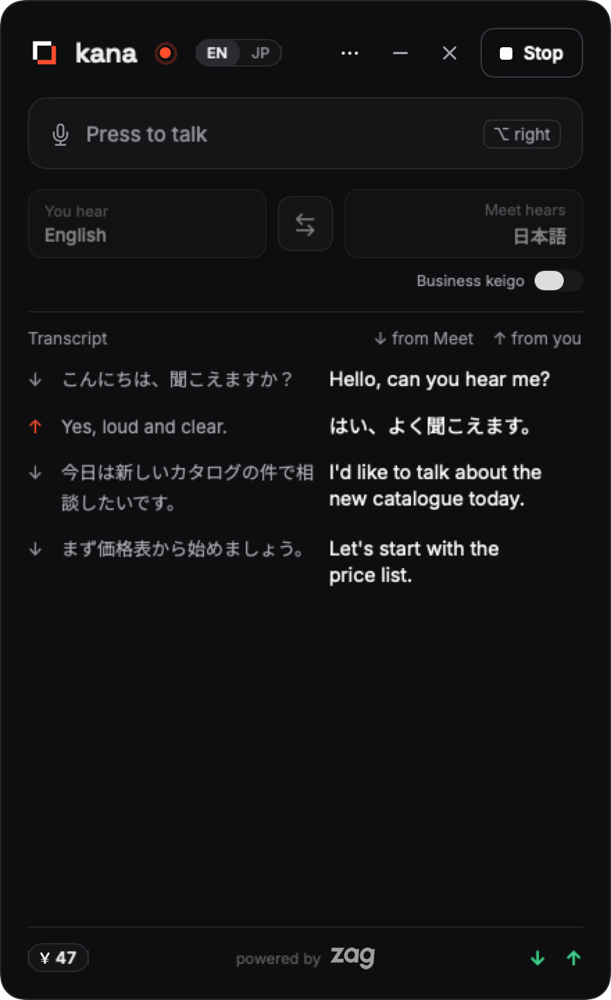
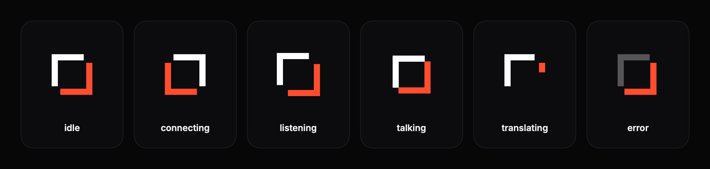
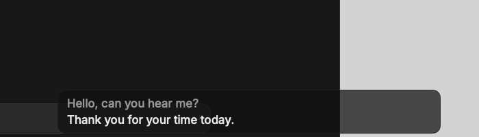
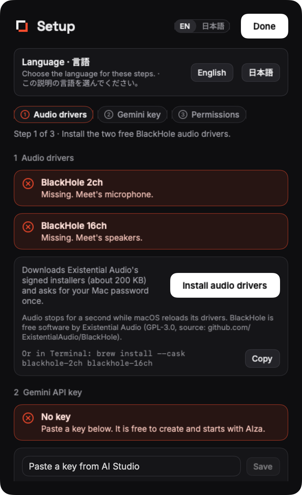

<p align="center">
  
</p>

<h1 align="center">kana</h1>

<p align="center">
  <b>live Japanese ⇄ English interpreting</b><br>
  For any meeting app on macOS. You speak English, they hear Japanese, in your own voice.
</p>

<p align="center">
  <a href="LICENSE"></a>
  <a href="https://github.com/selvaragulkumar/kana/releases"></a>
  
  
</p>

<p align="center">
  English · <a href="README.ja.md">日本語</a>
</p>

<!--
  A demo GIF (docs/demo.gif) is planned. It must show, in 30-60 seconds: the panel next to a
  Meet call with both sessions live; an inbound Japanese sentence and its English with the
  caption strip on; ⌃⌥Space turning Talk on and an English sentence going out in Japanese;
  the delay readout and the cost meter. No real participants' faces or names.
-->
<p align="center">
  
  <br><sub>The panel during a live session. A demo GIF is planned.</sub>
</p>

## TL;DR

```text
meeting audio ─► BlackHole 16ch ─► Gemini Live (ja→en) ─► your earphones
your mic ─────────────────────────► Gemini Live (en→ja) ─► BlackHole 2ch ─► meeting mic
```

Two Gemini Live sessions run side by side. One interprets the meeting into your earphones. The other interprets you into the meeting, only while Talk is on. A menu-bar panel shows both transcripts, the delay and what the call has cost so far.

**Status, 2026-11-12.** kana has been verified with recorded clips and the live Gemini API. The first live Google Meet call is still to come.

## Who is this for

- You join calls in Japanese and English, and the other side does not speak your language well.
- You want to talk, not type, and you want them to hear a voice, not read captions.
- You use a Mac and Google Meet, Zoom, Microsoft Teams or any app that lets you pick its microphone and speaker.
- You are fine with bringing your own Gemini API key and paying Google for the seconds of speech.
- You want a tool small enough to read in an afternoon: a handful of Python and Swift files.

It is not for interpreting a room, translating a recording, or a meeting where you cannot wear earphones. Japanese and English are the tested pair. Other pairs work through presets and BCP-47 codes but have had less testing.

## How it is different

> かな · live Japanese ⇄ English interpreting. The mark is a pair of Japanese corner brackets 「 」: the space between two languages.

<p align="center"></p>

Several good open-source projects cover parts of this. Two are close.

- **[Sokuji](https://github.com/kizuna-ai-lab/sokuji)** does the same two-way idea with eight providers, including the same Gemini Live Translate model, plus local models and a Chrome extension. It is an Electron app, captures all system audio on macOS for the inbound side, and ships analytics. If you want many providers or a browser extension, use Sokuji.
- **[Cicada](https://github.com/wquguru/cicada)** is a polished native menu-bar app with subtitles, meeting notes and a push-to-talk interpreter for your outbound voice. Inbound is subtitles, not speech. If you want notes and subtitles, use Cicada.

What kana does that we did not find combined anywhere else:

- **Speech in both directions, voice preserved both ways.** You hear the meeting in English, in a voice that follows the speaker's. The meeting hears you in Japanese, in a voice that follows yours. This comes from Gemini Live Translate's voice mirroring. If you need guaranteed keigo instead, `--register business` trades your voice for it (see [Register](#register)).
- **Loop-proof routing by construction.** The meeting's speaker and microphone are two different virtual devices, so the engine only hears the meeting and only the meeting hears the interpretation. See [docs/ARCHITECTURE.md](docs/ARCHITECTURE.md#why-the-routing-cannot-loop).
- **Cost and delay on screen.** The footer shows the running cost from Google's own token counts, and the median delay from speech to interpreted audio for each direction.
- **Silence is not sent.** A voice-activity gate keeps silence off the wire, and silence that is not sent is not billed.
- **Silence on same-language speech.** If you speak Japanese yourself, the outbound session says nothing, so you can switch languages mid-sentence.
- **A scriptable engine.** The same Python engine runs in a terminal, under tests, or behind the app over a JSON-lines protocol.
- **No telemetry.** One network host, listed below.

## Requirements

| What | Version or detail |
|---|---|
| macOS | 14 Sonoma or later |
| Mac | Apple silicon (verified); an Intel DMG is built but untested |
| BlackHole 2ch and BlackHole 16ch | free virtual audio drivers ([BlackHole](https://github.com/ExistentialAudio/BlackHole), GPL-3.0); kana's Setup installs them with one click |
| Python 3.13, Xcode Command Line Tools, [Homebrew](https://brew.sh) | only when building from source; the DMG carries its own Python |
| Gemini API key | from [Google AI Studio](https://aistudio.google.com/apikey); Google bills your account |
| Earphones | required; speakers let the interpretation leak back into your mic |

## Install

### Download

1. Download `kana-<version>.dmg` (Apple silicon) or `kana-<version>-intel.dmg` from the [Releases](https://github.com/selvaragulkumar/kana/releases) page. `checksums.txt` next to it has the SHA-256 sums.
2. Open the DMG and drag **kana** onto **Applications**.
3. Open kana from Applications. Until releases are notarised, macOS blocks the first open of a downloaded app:
   - macOS 14: right-click (or Control-click) kana › **Open** › **Open**.
   - macOS 15 and later: open it once, then go to System Settings › Privacy & Security, press **Open Anyway** next to kana, and confirm.
4. kana sits in the menu bar. Its panel opens with **Setup**, one step at a time:
   1. **Audio drivers.** Press **Install audio drivers** and enter your Mac password once. kana downloads Existential Audio's signed BlackHole 2ch and 16ch installers (about 200 KB, checked against the Homebrew casks' SHA-256 and the vendor's signature), installs both and reloads macOS audio, so no restart is needed. If the devices still do not appear, Setup says so: restart the Mac.
   2. **Gemini API key.** Create a free key at [aistudio.google.com/apikey](https://aistudio.google.com/apikey), paste it and press **Save**. It goes into your login Keychain.
   3. **Permissions.** Allow the microphone, and turn on kana in Accessibility for the ⌃⌥Space hotkey.
5. Set Meet's microphone to BlackHole 2ch and its speakers to BlackHole 16ch (see [Wiring](#wiring)), put on earphones and press **Start**.

The app is about 140 MB because it carries its own Python 3.13 runtime and the engine; nothing else is installed besides the two drivers.

### Homebrew (coming)

A cask in a tap that also installs both BlackHole drivers is planned. Until then, use the DMG or build from source.

### Build from source

```sh
# 1. Virtual audio devices (asks for your Mac password; log out or restart afterwards)
brew install --cask blackhole-2ch blackhole-16ch

# 2. The engine
git clone https://github.com/selvaragulkumar/kana.git
cd kana
python3.13 -m venv .venv
.venv/bin/pip install -e .

# 3. The menu-bar app
app/build.sh --install               # builds and copies kana.app to /Applications
open /Applications/kana.app
```

`build.sh --install` records this checkout as the engine folder, unless one is already set. If you move the checkout, pick the folder again on the app's Setup page.

A DMG build carries its own engine and uses it. To run a checkout with it instead (engine development), press **Use a Checkout…** under Setup › Engine and pick the folder; **Use Built-in** switches back. To build the DMG yourself: `app/release.sh` (see [docs/RELEASE_CHECKLIST.md](docs/RELEASE_CHECKLIST.md)).

**API key.** Open **Setup…** from the panel's ••• menu, paste your Gemini key and press **Save**. The key goes into your login Keychain. For the command line, or as a fallback when no Keychain key is set, the engine also reads a `.env` file:

```sh
printf 'GEMINI_API_KEY=%s\n' 'paste-your-key-here' > .env
chmod 600 .env
```

`sounddevice` ships its own PortAudio library on macOS, so no separate PortAudio install is needed. Install `ffmpeg` (`brew install ffmpeg`) only if you want to run the tests or the WAV examples below.

A source build is signed with your local "kana Local Signing" certificate if you have one, otherwise ad-hoc. The first time, macOS may ask you to confirm opening it.

## Wiring

kana uses four audio devices. Two of them are virtual cables from BlackHole: whatever is played into one end comes out of the other.

| Device | Kind | Who plays into it | Who records from it |
|---|---|---|---|
| Your microphone | recording device | your voice | kana (outbound) |
| BlackHole 2ch | virtual cable | kana (outbound interpretation) | the meeting app, as its **microphone** |
| BlackHole 16ch | virtual cable | the meeting app, as its **speaker** | kana (inbound) |
| Your earphones | playback device | kana (inbound interpretation) | your ears |

So the meeting never hears your real microphone, and your earphones never hear the uninterpreted meeting.

Set the meeting app once:

| App | Where | Microphone | Speaker |
|---|---|---|---|
| Google Meet (browser) | Settings (gear icon) › Audio | BlackHole 2ch | BlackHole 16ch |
| Zoom (desktop), not yet tested by us | Settings › Audio | BlackHole 2ch | BlackHole 16ch |
| Microsoft Teams (desktop), not yet tested by us | Settings › Devices › Audio devices | BlackHole 2ch | BlackHole 16ch |

Leave the macOS sound output on your earphones (System Settings › Sound › Output). In kana, pick your real microphone and your earphones. The two BlackHole devices are fixed and need no setting.

The app's **Setup** page, under ••• › **Setup…**, checks the wiring for you. It also opens by itself on the first open after a launch while a driver, the key or microphone access is missing, and when a start fails with a device or key error. The main panel does not show routing or BlackHole warnings; Setup does. It shows the three first-run steps (audio drivers with the **Install audio drivers** button, the key, microphone and Accessibility access), the meeting settings and the engine in use. **Test devices** plays a 1-second tone into each BlackHole device and listens for it. Do not run it during a call.

Zoom and Teams need the same two settings as Meet, but we have not tried them yet.

## Usage

### Menu-bar app

<p align="center"> </p>

1. Click the kana mark in the menu bar.
2. Pick **Microphone** (your real microphone) and **Earphones**. The app remembers them.
3. Check the language cards: **You hear English** on the left, **Meet hears 日本語** on the right, with a ⇄ button to swap them. Click either card for the presets, which pair English with Japanese, Chinese, Korean, Spanish, French, German, Hindi or Tamil. **Custom…** takes any two BCP-47 codes.
4. When the meeting hears Japanese, a small **Business keigo** switch sits under the cards on the right. It is off by default, so the Japanese mirrors how you speak. Turn it on for `--register business`; its tooltip notes that the outbound voice becomes a stock voice, and the right card then reads "Meet hears · business keigo". See [Register](#register).
5. Press **Start**. Both sessions connect, the pill in the header changes from Idle to Live, and inbound interpretation starts right away.
6. Press the talk bar ("Press to talk ⌃⌥ Space"), or **⌃⌥Space** from any app, to send your voice. It is a toggle, not hold-to-talk. While on it reads "Talking · English → 日本語". Outbound always starts muted. Press again to mute.
7. Read both directions in the transcript. The footer shows the call time and the running cost, for example "0:00 · $0.00 · ≈¥0", with " est." until the engine reports Google's token counts. The IN and OUT labels show a green dot when live and the median delay, for example "IN live · 1.8 s".

A dashed chip in the header shows "fallback model" when `gemini-3.8-live` is in use, and "fake engine" when testing with `app/fake_engine.py`. With the default model it shows nothing.

**Captions.** Off by default. Turn them on in the ••• menu or from a right-click on the menu-bar icon. A small click-through strip at the bottom of the screen, at most 560 pt wide, shows the newest line you heard and, dimmed, the one before it. Each line fades 8 seconds after its last update. The strip stays above other apps and works while the panel is closed.

<p align="center"></p>

**Screen sharing.** The panel and the caption strip are left out of screen shares, recordings and screenshots by default. Turn on **Visible in screen share** in the ••• menu to show them.

**Transcripts.** Each call is saved as Markdown and SRT unless you turn off **Save transcripts** in the ••• menu. **Open Last Transcript** and **Transcripts Folder** are in the same menu.

**Setup.** ••• › **Setup…** walks through three steps: both BlackHole devices with a one-click install and a loopback test, the API key, and the microphone and Accessibility permissions. Below them are the meeting settings and the engine (built in, or a checkout). See [Wiring](#wiring).

<p align="center"></p>

**Hotkey.** ⌃⌥Space needs Accessibility access. Press **Open Settings** in the panel and switch kana on under Privacy & Security › Accessibility. The talk bar works without it.

### Command line

The engine runs on its own in a terminal:

```sh
.venv/bin/python -m kana --spk "AirPods"
```

**Space** toggles Talk and **q** quits. Transcripts of both directions print as they arrive. `kana` also works as a console script inside the venv.

| Flag | Default | Meaning |
|---|---|---|
| `--mic NAME` | system default input | your real microphone (case-insensitive substring) |
| `--spk NAME` | system default output | your earphones |
| `--meet-mic NAME` | BlackHole 2ch | the device the meeting app uses as its microphone |
| `--meet-spk NAME` | BlackHole 16ch | the device the meeting app uses as its speaker |
| `--in LANG` | `en` | the language you hear (BCP-47) |
| `--out LANG` | `ja` | the language the meeting hears (BCP-47) |
| `--model ID` | `gemini-3.5-live-translate-preview` | Live model; `gemini-3.8-live` is the stable fallback |
| `--register default\|business` | `default` | outbound Japanese register; see [Register](#register) |
| `--vad auto\|off` | `auto` | voice-activity gate: `auto` does not send silence; `off` streams everything |
| `--vad-threshold N` | `200` | minimum speech level (RMS of a 100 ms int16 chunk); background noise is also learnt automatically |
| `--vad-hangover MS` | `2000` | audio still sent after speech ends, so the model can finish the sentence |
| `--save-dir DIR` | `~/Library/Application Support/kana` | transcripts go to `DIR/transcripts/` |
| `--no-save` | | do not save transcripts |
| `--only in\|out` | both | run one direction |
| `--in-file X.wav` / `--out-file X.wav` | | replace the meeting capture or your microphone with a WAV; it starts once its session connects |
| `--dump-in X.wav` / `--dump-out X.wav` | | also save the interpreted audio |
| `--list-devices [--json]` | | list audio devices and exit |
| `--json` | | JSON lines on stdout and commands on stdin, for the app ([protocol](docs/ENGINE.md)) |

Try the inbound path without a meeting:

```sh
say -v Kyoko -o /tmp/ja.aiff "こんにちは、今日は天気がいいですね。"
ffmpeg -y -i /tmp/ja.aiff -ar 16000 -ac 1 /tmp/ja.wav
.venv/bin/python -m kana --only in --in-file /tmp/ja.wav --dump-in /tmp/en.wav
```

## Privacy and permissions

| macOS permission | Why | Without it |
|---|---|---|
| Microphone | to record your microphone and the BlackHole 16ch cable | no audio is captured; nothing is interpreted |
| Accessibility | to see the ⌃⌥Space key press while another app is in front | the global hotkey does nothing; the talk bar still works |

Your microphone is sent only while Talk is on. Meeting audio is sent while the engine runs. In both directions a voice-activity gate holds back silence by default, so only speech, plus a short margin around it, leaves your Mac. Audio is not saved unless you pass `--dump-in` or `--dump-out`. The API key is kept in your login Keychain, or in `.env` if you use that instead, and leaves your Mac only as the credential sent to Google. Details are in [SECURITY.md](SECURITY.md).

**Transcripts are saved by default.** Each run writes a Markdown table and an SRT file to `~/Library/Application Support/kana/transcripts/`, named by date and time, as plain unencrypted text. Turn off **Save transcripts** in the app, or pass `--no-save` or `--save-dir` on the command line.

Tell the other people in the call that their audio goes to an interpreting service.

## Transparent networking

| Component | Host | What for |
|---|---|---|
| Engine (Python) | `generativelanguage.googleapis.com` | the two Gemini Live sessions (WebSocket over TLS) |
| App (Swift) | `existential.audio` | only when you press **Install audio drivers**: downloads the two BlackHole installers (the URLs the Homebrew casks use) |

Otherwise the app only talks to the engine over stdin and stdout. There is no telemetry, no analytics, no crash reporting and no update check. Installing from source also contacts Homebrew, GitHub and PyPI, as any install does.

## Models

| Model | Used for | Notes |
|---|---|---|
| `gemini-3.5-live-translate-preview` | both directions by default | Gemini Live Translate. Direct speech-to-speech with voice mirroring, so the interpretation sounds like the speaker. Preview: Google may change or retire it. Available on the Gemini Developer API only, not on Vertex AI. |
| `gemini-3.8-live` | outbound with `--register business`, or both with `--model gemini-3.8-live` | Generally available Live model, driven by a system instruction. Speaks in a stock voice. |

### Register

Japanese changes with formality. The `--register` flag decides how the outbound Japanese is produced.

| `--register` | Inbound | Outbound, when the meeting hears Japanese | Your voice | Politeness |
|---|---|---|---|---|
| `default` (the default) | Live Translate | Live Translate | kept | mirrors yours |
| `business` | Live Translate | `gemini-3.8-live` with a keigo instruction | stock voice | です・ます and keigo guaranteed |

The default mirrors how you speak. Speak neutral or polite English and the meeting hears polite Japanese: in our test, 24 of 24 neutral and polite inputs came out polite or in keigo. Casual English comes out casual: 12 of 12 casual inputs became タメ口, such as 「うん、それでいいよ。」. Business mode produced no casual output in 36 tries, with 31 in full keigo. It costs your voice and about 0.45 s of extra delay. The method and every output are in [docs/REGISTER.md](docs/REGISTER.md).

In the app, the **Business keigo** switch under the language cards turns business mode on. The panel no longer explains the default's behaviour, so remember: speak neutral or polite English for polite Japanese. When the meeting language is not Japanese, business mode leaves the outbound direction on Live Translate.

## Cost

You pay Google for the audio each direction sends and receives. The engine prices each direction at its own model's rates, from the token counts the API reports (`usage_metadata`), not from a clock, and the footer shows that figure. Before the first report it shows an estimate from seconds of audio, marked "est.". The Google Cloud billing console is the final word.

Prices from the [Gemini API pricing page](https://aistudio.google.com/docs/pricing), read on 2026-11-12, at 25 audio tokens per second:

| Model | Input audio | Output audio | One minute of speech, one direction |
|---|---|---|---|
| `gemini-3.5-live-translate-preview` | $3.50 per 1M tokens | $21 per 1M tokens | ≈ $0.037 |
| `gemini-3.8-live` | $3.00 per 1M tokens | $12 per 1M tokens | ≈ $0.0225, plus text tokens for the instruction, which Google bills but kana's figure leaves out |

**Silence that is not sent is not billed.** We measured this on 2026-11-12 from the API's own counts. Live Translate bills output in step with the input it is sent, so silence that is sent is billed both ways. The voice gate cut a test run's cost by 80%:

| Run, each with the same 5 s of speech | Voice gate | Cost |
|---|---|---|
| 22 s clip | off | $0.01225 |
| 22 s clip | on | $0.00245 |
| 75 s session | on | $0.00245 |

So real cost scales with seconds of speech, not with the length of the call: about $0.037 per minute of speech per direction on Live Translate. With both directions talking non-stop, the upper bound is about $0.074 per minute with `--register default`, and about $0.06 per minute with `--register business`. The yen figure in the footer uses a fixed 150 yen per dollar.

Full measurements are in [docs/ENGINE.md](docs/ENGINE.md#cost).

## Limitations

- **Preview model.** The default model is a preview. Its behaviour, price or availability can change without notice.
- **Delay.** Interpretation starts about 3 seconds after the speaker starts. Turn-taking feels slower than a normal call. The footer shows the measured delay.
- **Register follows you.** In the default mode, casual English becomes casual Japanese. Speak neutrally, or use `--register business` and give up your voice.
- **No speaker labels.** All remote participants arrive as one stream. Voice mirroring is the only hint of who is speaking.
- **Manual meeting settings.** You set the microphone and speaker in each meeting app yourself, and set them back afterwards. Setup shows the checklist but cannot change them for you.
- **Earphones only.** With speakers, your microphone can pick up the English and, while Talk is on, send it back interpreted.
- **Reconnects drop audio.** Sessions are renewed about every 10 minutes. Speech during the second or two of a reconnect is not interpreted.
- **The voice gate is energy-based.** Steady background noise is learnt within about 5 seconds, but loud or changing noise can still count as speech and be sent. A very quiet speaker can be held back. Raise or lower `--vad-threshold`, or use `--vad off`.
- **Transcripts are plain files.** Saved transcripts are not encrypted. Anyone with access to your user account can read them.
- **Not notarised yet.** Releases are not signed with an Apple Developer ID, so the first open needs the Gatekeeper steps under [Download](#download). Source builds are signed with a local certificate when you have one (`build.sh` uses `KANA_SIGN_IDENTITY`, or a certificate named "kana Local Signing"), which keeps macOS permission grants across rebuilds; an ad-hoc signed build can make macOS forget the Accessibility grant, so switch it off and on again if the hotkey stops working.
- **macOS only.**

## Repository layout

```text
kana/
├── kana/                 Python engine (python -m kana)
│   ├── __main__.py       flags, device plan, loop guard, wiring of both directions
│   ├── session.py        one Gemini Live session per direction: reconnect, resumption, register, usage
│   ├── audio.py          device lookup, capture (16 kHz), playback (24 kHz), resampling, WAV input
│   ├── vad.py            energy voice-activity gate: what is sent and when an utterance starts
│   ├── transcripts.py    saved Markdown and SRT transcripts
│   ├── events.py         JSON-lines protocol: events out, commands in
│   └── ptt.py            terminal push-to-talk (space, q)
├── app/                  Swift menu-bar app
│   ├── Sources/          panel, caption strip, Setup, Keychain, engine process, hotkey, brand
│   ├── Resources/Fonts/  Inter, Noto Sans JP and Space Grotesk (SIL OFL), bundled into the app
│   ├── build.sh          builds kana.app with Command Line Tools only (--bundle-engine: with its own Python)
│   ├── bundle_engine.sh  relocatable Python 3.13 + the engine, from python-build-standalone
│   ├── release.sh        the DMG: build, sign, optional notarisation, checksums
│   ├── fetch_drivers.sh  BlackHole installers into the app (only with Existential Audio's permission)
│   ├── drivers/          BlackHole licence and why the installers are downloaded, not shipped
│   ├── entitlements/     hardened-runtime entitlements for notarised builds
│   ├── fake_engine.py    stands in for the engine when testing the app
│   └── icon.png          app icon, rendered from design/kana-app-icon.svg
├── design/               logo, mark, menu-bar template and app icon (SVG), design notes
├── tests/                pytest suite; test_live.py calls the real API (opt-in); register_eval.py
├── docs/
│   ├── ARCHITECTURE.md   devices, process model, loop-proof routing, session lifetime
│   ├── ENGINE.md         flags, JSON protocol, voice gate, delay, cost measurements
│   ├── REGISTER.md       outbound Japanese register evaluation
│   ├── ROADMAP.md        what comes next
│   ├── research/         open-source survey
│   └── superpowers/specs/ design specs
└── pyproject.toml
```

## Uninstall

```sh
osascript -e 'quit app "kana"'
rm -rf /Applications/kana.app
rm -rf ~/Library/Application\ Support/kana          # also deletes saved transcripts
defaults delete com.selvaragulkumar.kana             # saved devices, languages and toggles
security delete-generic-password -s com.selvaragulkumar.kana -a GEMINI_API_KEY   # the Keychain key
tccutil reset Accessibility com.selvaragulkumar.kana
tccutil reset Microphone com.selvaragulkumar.kana
```

Set your meeting apps back to your real microphone and speaker first, then remove the drivers if nothing else uses them. If Homebrew installed them:

```sh
brew uninstall --cask blackhole-2ch blackhole-16ch
```

If kana's Setup installed them:

```sh
rm -rf ~/Library/Caches/kana
sudo rm -rf /Library/Audio/Plug-Ins/HAL/BlackHole2ch.driver /Library/Audio/Plug-Ins/HAL/BlackHole16ch.driver
sudo pkgutil --forget audio.existential.BlackHole2ch
sudo pkgutil --forget audio.existential.BlackHole16ch
sudo killall coreaudiod
```

Finally, delete the cloned folder if you built from source (it may hold a `.env`) and, if you no longer need it, delete the API key in Google AI Studio.

## 日本語

日本語の README は [README.ja.md](README.ja.md) にあります。

## Contributing, security, licence

- [CONTRIBUTING.md](CONTRIBUTING.md): setup, the local test gate, adding a language pair, the protocol rule.
- [SECURITY.md](SECURITY.md): how the key is stored, what is sent where, how to report a problem.
- [CODE_OF_CONDUCT.md](CODE_OF_CONDUCT.md)
- [CHANGELOG.md](CHANGELOG.md) and [docs/ROADMAP.md](docs/ROADMAP.md)
- [THIRD_PARTY_NOTICES.md](THIRD_PARTY_NOTICES.md): BlackHole is GPL-3.0 and is never bundled; you install it yourself.

Licensed under the [Apache License 2.0](LICENSE). Copyright 2026 [Selva Ragul Kumar](https://selvaragulkumar.com).

kana is not affiliated with Google, Zoom, Microsoft or Existential Audio.
