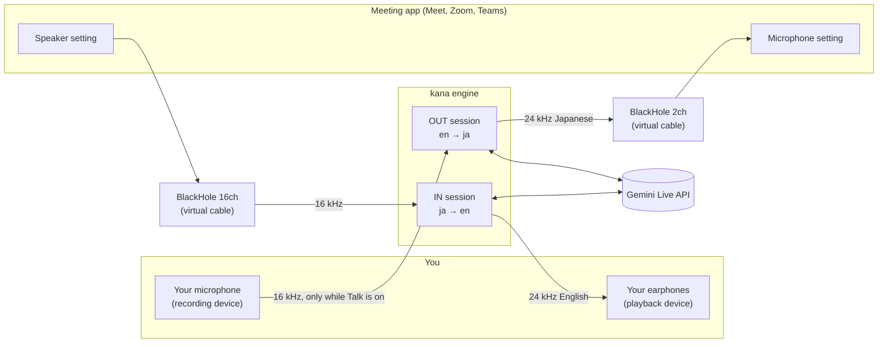
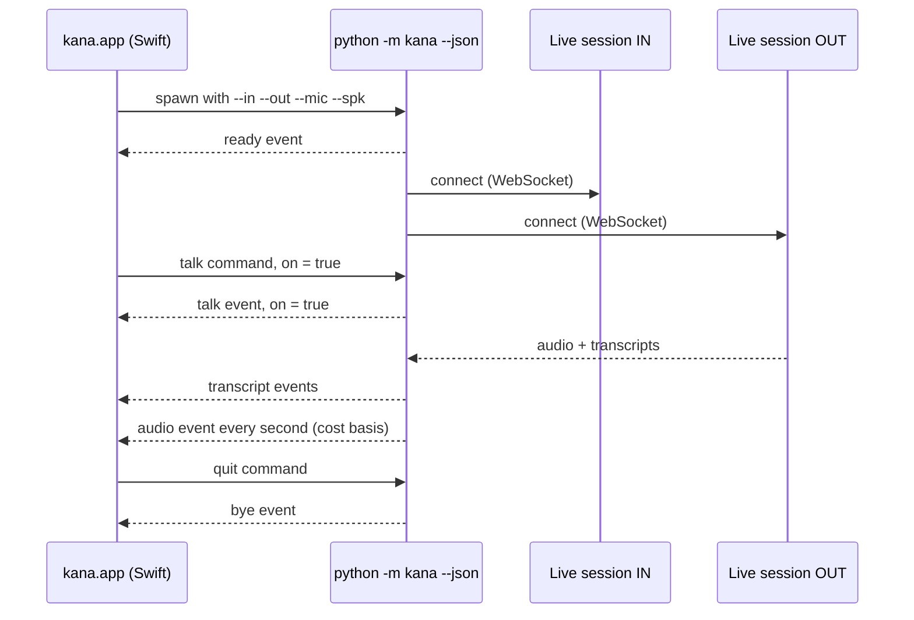

# Architecture

kana is two independent translation pipelines that share one process and one push-to-talk flag. This page explains how audio flows, how the app and the engine talk, why the routing cannot loop, and how the code is tested without a microphone or an API key.

Design history lives in [superpowers/specs/](superpowers/specs/): the engine in `2026-11-12-meet-translate-design.md` and the app in `2026-11-12-menubar-app-design.md`. The JSON protocol reference is [ENGINE.md](ENGINE.md).

## Two directions, four devices

The defaults are shown: you hear English (`--in en`) and the meeting hears Japanese (`--out ja`). Any BCP-47 pair works.

| Device | What writes to it | What reads from it |
|---|---|---|
| Your microphone | your voice | the engine's OUT direction |
| BlackHole 2ch | the engine's OUT direction | the meeting app, as its microphone |
| BlackHole 16ch | the meeting app, as its speaker | the engine's IN direction |
| Your earphones | the engine's IN direction | your ears |

A BlackHole device is a loopback cable: audio played into its output side comes out of its input side. Two separate BlackHole devices give two separate cables.

## Process model

- **The app** (`app/`) is a SwiftUI `MenuBarExtra` with no Dock icon. It has no network code. Its only audio of its own is the Setup page's test tone, which it plays into each BlackHole device and listens for, to check the wiring. It starts the engine as a child process, reads JSON lines from its stdout, writes commands to its stdin, and keeps the last few KB of stderr to explain an unexpected exit. It lists devices by running the engine once with `--list-devices --json`.
- **The engine** (`kana/`) is an asyncio program. `__main__.py` resolves devices and starts one `Direction` per enabled direction. `audio.py` captures at 16 kHz mono int16 in 100 ms chunks and plays 24 kHz mono int16, resampling linearly when a device cannot open at that rate. `session.py` holds one Live session per direction. `vad.py` is the energy voice-activity gate. `transcripts.py` saves each call as Markdown and SRT. `events.py` is the JSON protocol. `ptt.py` is the terminal push-to-talk.
- **The JSON lines** are the only interface between the two. Without `--json` the same engine runs in a terminal with plain-text transcripts and space-bar push-to-talk. See [ENGINE.md](ENGINE.md) for every event and command.
- **The Live sessions** are independent. Each has its own model, target language, resumption handle and reconnect loop. A failure in one direction never stops the other. By default both use Live Translate. With `--register business` and Japanese as the meeting language, the outbound session uses `gemini-3.8-live` with a keigo instruction instead; the `ready` event names the model of each direction. See [REGISTER.md](REGISTER.md).
- **Cost** comes from the server, not from a clock. Each session's messages carry `usage_metadata` token deltas, which the engine sums per direction and reports in a `usage` event and in the per-second `audio` event.

Capture never blocks. Each direction's input queue holds at most 50 chunks (5 seconds); when it is full the oldest chunk is dropped. The sender drains the queue all the time and only forwards chunks while a session is connected and, for the outbound direction, while Talk is on. When Talk turns off, the engine sends one end-of-audio marker so the model can finish the half-spoken sentence, then sends nothing.

Between the queue and the session sits the voice-activity gate (`--vad auto`, the default, in both directions). A 100 ms chunk counts as speech when its level is above both `--vad-threshold` and three times the quietest chunk of the previous 5 seconds, so steady background noise is learnt. At speech onset the last 300 ms are released too, so word starts are not clipped. After speech ends, 2 seconds more are sent (the model needs them to finish the sentence), then one end-of-audio marker. Silence in between is not sent and not billed.

The same onsets drive the latency readout and saved transcripts. An utterance runs from a speech onset until the next onset or 1.5 seconds of quiet. When it closes, the engine emits a `latency` event (onset to first translated audio, and source transcript to translated transcript) and appends one row to the saved Markdown and SRT files. The per-second `audio` event carries the median latency and the seconds the gate held back.

## Why the routing cannot loop

A feedback loop needs a path from one of the engine's outputs back to one of its inputs. List the outputs and follow them.

1. **OUT writes to BlackHole 2ch.** The only reader of BlackHole 2ch is the meeting app's microphone. The engine never opens BlackHole 2ch as an input. So the outbound translation reaches the remote participants and nothing else.
2. **The meeting app writes the remote audio to BlackHole 16ch.** The only reader is the engine's IN direction. The remote participants' audio never reaches your earphones untranslated and never reaches BlackHole 2ch.
3. **IN writes to your earphones.** Earphones are a physical device with no capture side, so no software path leads back from them.
4. **Your microphone feeds only OUT.** The meeting app never sees your real microphone, so your untranslated voice never reaches the meeting.

Because each cable has exactly one writer and one reader, a loop would need a device to be both. The engine checks that at start-up: it exits with an error when both directions would capture the same device, or when the earphones and the meeting microphone are the same device.

Two things are outside the software and are the user's job:

- **Use earphones, not speakers.** If the inbound English plays through laptop speakers, your microphone can pick it up acoustically. While Talk is on, the outbound direction would then translate it and send it to the meeting.
- **Set the meeting app's speaker to BlackHole 16ch.** If it stays on your earphones, you hear the original audio as well as the translation. This is not a loop, but it is confusing.

Same-language speech also stays silent. Both directions set `echo_target_language=False`, so if you speak the meeting's language yourself, the outbound direction produces nothing, and the same holds for inbound speech already in your language.

## Session lifetime

A meeting lasts longer than a Live connection. Each `Direction.run()` loop handles that.

| Limit or signal | What the engine does |
|---|---|
| A single WebSocket connection lasts about 10 minutes. | The server sends `go_away` with the time left. The engine reconnects at once with the latest resumption handle. The app sees `session` `reconnecting` with detail `go_away`, then `connected`. |
| Audio-only sessions are capped at 15 minutes of context. | `context_window_compression` with a sliding window is set on every connection, so old context is dropped instead of the session ending. |
| Session state across connections | `session_resumption` is set on every connection. Each `session_resumption_update` with a new handle replaces the stored handle. The next connect passes it, so the model keeps the conversation. |
| Network error, server error, unexpected close | Reconnect after 1 s, 2 s, then 4 s for every further try. The counter resets once a message arrives. The app sees `session` `reconnecting` with detail `error: ...`. |
| Partial sentences at a disconnect | Pending transcript text is flushed before reconnecting, so nothing already heard is lost from the transcript. |

Audio that arrives while a direction is reconnecting is dropped, not queued. You may miss up to a second or two of speech during a reconnect.

## Test seams

Nothing in the default test run needs a microphone, a BlackHole device, a network or an API key.

| Seam | Where | What it replaces |
|---|---|---|
| `connect=` injection | `Direction(..., connect=...)` in `kana/session.py` | The real `client.aio.live.connect`. Unit tests pass a fake session that yields scripted server messages, `go_away` and errors. |
| WAV injection | `--in-file`, `--out-file` | The meeting capture and your microphone. The WAV is fed in real time in 100 ms chunks, then silence. |
| Audio dumps | `--dump-in`, `--dump-out` | Nothing; they also write the translated audio to a WAV so you can listen to it. |
| One direction | `--only in`, `--only out` | Runs a single pipeline. |
| Command stream | `amain(..., emit=..., commands=...)` in `kana/__main__.py` | stdout and stdin of the JSON protocol. |
| Fake engine | `app/fake_engine.py` | The whole Python engine, for testing the app. It speaks the JSON protocol with canned transcripts, a reconnect, a non-fatal error and cost ticks, and `FAKE_ENGINE_FATAL=1` adds a fatal error. |
| Fake clock | `Direction(..., clock=...)` | `time.monotonic`, so utterance, latency and reconnect tests run without waiting. |
| Register evaluation | `tests/register_eval.py` | Nothing; it runs 12 English utterances through the outbound direction against the real API and writes the Japanese for grading. Costs a few cents. |
| Live test | `tests/test_live.py`, `pytest -m live` | Nothing; it sends a `say`-generated Japanese WAV to the real API and checks the English transcript. Skipped without `GEMINI_API_KEY`. |
